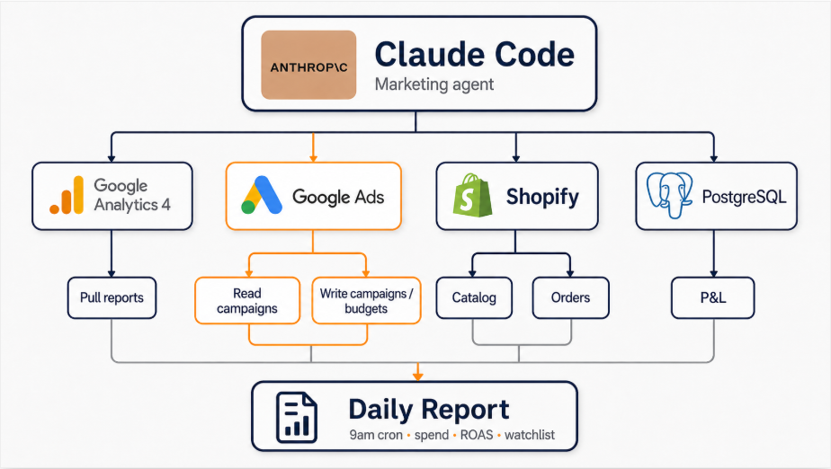

# linkedin-post — a Claude Code skill

End-to-end LinkedIn posting workflow for Claude Code. Drafts a result-driven post, generates a tree architecture diagram with real service logos, and publishes to your personal LinkedIn — all through browser automation, using your existing ChatGPT and LinkedIn sessions. No API keys, no Zoho subscription, no LinkedIn Developer app.

Built and battle-tested 2026-05-13 while shipping [this post](https://www.linkedin.com/feed/update/urn:li:share:7460423004343169024/).

## What it looks like

The skill produces posts in this opinionated structure:

> *Hook (concrete result, never "Excited to share")*
>
> *2–4 short paragraphs: the WHY — the real problem you were facing*
>
> *1–3 lines: the OUTCOME — a specific concrete win with a number ("diagnosed in 90 seconds")*
>
> *3–6 emoji bullets: 📊 🤖 ⚡ 🔧 — what you built*
>
> *Brief operating paragraph*
>
> *Open question to peers (specific, not generic)*
>
> *3–5 trending hashtags*

And it generates accompanying architecture diagrams that look like:



## Why this exists

Generic AI drafters give you LinkedIn slop. This skill bakes in:

- **Banned vocabulary** — no `delve / leverage / unlock / transformative / comprehensive / robust / nuanced / multifaceted / furthermore / moreover / pivotal / landscape / tapestry / underscore / foster / showcase / intricate / vibrant`
- **Banned punctuation** — no em dashes, no exclamation points outside quoted speech
- **Tree-not-centered diagrams** — flat hub-and-spoke diagrams look like marketing slides; tree layouts read as technical
- **Real service logos** — GPT-image renders actual Google Analytics, Google Ads, Shopify, PostgreSQL, Anthropic etc. logos when prompted explicitly
- **Three discovered gotchas baked into the skill** (multi-task collapse on Thinking model, the hidden "Next" button in LinkedIn's image editor, screenshot-the-lightbox-not-the-chat)
- **Three mandatory approval gates** so you never accidentally post

## Installation

```bash
git clone https://github.com/wqc3241/linkedin-post-skill.git ~/.claude/skills/linkedin-post
```

That's it. Claude Code auto-discovers skills in `~/.claude/skills/`.

## Prerequisites

- **Claude Code** with the **Playwright MCP** loaded. The skill drives `mcp__plugin_playwright_playwright__*` tools for both ChatGPT and LinkedIn.
- A **ChatGPT account** (Plus / Pro / Team recommended — free tier works for text but not image generation).
- A **LinkedIn account**. The skill handles Google-OAuth auto-signin if your playwright browser has Google session cookies; otherwise you log in manually in the playwright window.

## Usage

### Full pipeline (default)

```
/linkedin-post
```

The agent asks you a small brief (topic, real problem, outcome with a number, tech stack, audience), drafts the post via ChatGPT, generates the diagram, shows you both for review, then publishes after a final approval gate.

You can also seed the topic in the invocation:

```
/linkedin-post about my new caching layer that cut p95 latency from 800ms to 40ms
```

### Draft only (no publishing)

```
/linkedin-post draft
```

Same drafting flow, but stops before publishing. Saves the post text + diagram to `.playwright-mcp/` and tells you the paths. Useful when you want to schedule manually or post from a different device later.

### Publish only (use pre-made artifacts)

```
/linkedin-post publish --file path/to/post.md --image path/to/diagram.png
```

Skip the drafting entirely. Opens LinkedIn, fills the composer with your existing files, prompts for final approval, publishes.

## How it works (mechanics)

The skill is a single `SKILL.md` file describing a workflow for Claude Code. When the user invokes `/linkedin-post`, Claude reads the skill, then drives:

1. **ChatGPT.com** (for content + image generation)
   - Navigates via playwright
   - Verifies the playwright browser has an authenticated session
   - Switches to the Thinking model (better text, slower)
   - Sends drafter prompt with the embedded structure + voice rules
   - Sends image-gen prompt as a **separate turn** (multi-task collapse otherwise)
   - Screenshots the generated image from the fullscreen lightbox (cleaner than inline)

2. **LinkedIn.com** (for publishing)
   - Auto-signin via Google or manual login fallback
   - Opens "Start a post" composer
   - Types the post body, uploads the diagram via `browser_file_upload`
   - Clicks the easy-to-miss "Next" button in the image editor
   - Final approval gate — screenshot composer + AskUserQuestion before clicking Post
   - Captures the `urn:li:share:...` URL from the success toast

The skill encodes the selectors, wait times, and known failure modes discovered during the original build session.

## Failure modes the skill handles

| Symptom | Fallback |
|---|---|
| ChatGPT shows "Log in" buttons | Ask user to log in in the playwright window |
| "You've hit your usage limit. Upgrade to Pro..." | Offer to wait, use a different drafter, or post manually |
| Multi-task model collapse (only image OR text returned) | Send the missing piece as a follow-up turn |
| LinkedIn Post button stays disabled after image upload | Click the hidden "Next" button in the image editor first |
| Selectors don't match | Re-snapshot, find by ARIA role + accessible name |
| Snapshot too large to inline | Save to file via `filename:` param, grep |
| ChatGPT image text artifacts (e.g., "ANTHROP\C") | Surface to user, regenerate if egregious |

## Alternative: API-based posting

The skill uses browser automation because it's setup-free. If you'd prefer the LinkedIn Developer API path (no browser, scriptable from CI), the original build session also produced a working CLI for that — see [scripts/linkedin-post.mjs in turn14-integration](https://github.com/wqc3241/turn14-integration/blob/master/scripts/linkedin-post.mjs). 15-minute one-time OAuth setup, then any future post is one `node linkedin-post.mjs post --file X --image Y` command.

## Contributing

This skill improves with each invocation — if you hit a new failure mode (selector drift, model name changes, new LinkedIn UI flows), the skill is meant to be updated directly. PRs welcome.

## License

[MIT](LICENSE)
